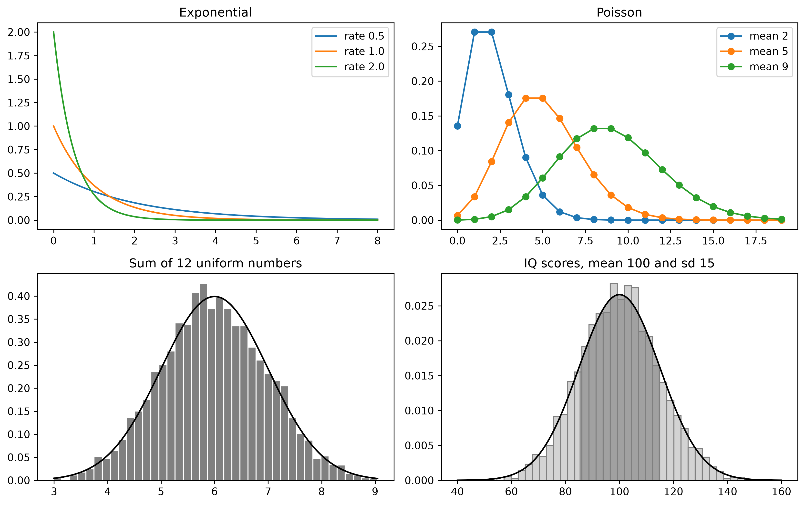

# Experiment 2: Plotting the Probability Distribution Curve

> **File:** `exp2.py`  |  **Tools:** Python 3, NumPy, SciPy, Matplotlib

## 🎯 Aim

To plot probability distribution curves and use them to find probabilities.

## 📘 Theory

A probability distribution tells how the values of a random variable are spread. For a continuous variable the density curve is drawn and the area under it between two points is a probability; for a counting variable the probability mass is drawn as bars or points. Four distributions are plotted: the exponential (waiting time), the Poisson (number of events), the normal, and the normal shape that appears when 12 uniform random numbers are added (central limit theorem).

The normal density with mean μ and variance σ² is:

- **Exponential**: Waiting time with mean 1/rate.
- **Poisson**: Number of events in a fixed period.
- **Central limit theorem**: Sums of many small random terms look normal.
- **z-score**: (x − μ)/σ

### 📐 Formulas

$$ N\left(x | \mu , {\sigma }^{2}\right) = \frac{1}{\sqrt{2\pi {\sigma }^{2}}}{e}^{-\frac{{\left(x - \mu \right)}^{2}}{2{\sigma }^{2}}} $$

## 🪜 Algorithm / Steps

1. Plot exponential curves for three rates and Poisson probabilities for three means.
2. Add 12 uniform numbers 4000 times and compare the histogram with the normal curve.
3. Shade the middle of an IQ distribution (mean 100, standard deviation 15).
4. Calculate probabilities, percentiles, the z-score and compare with a simulation.

## 💻 Code

```python
import numpy as np
import matplotlib.pyplot as plt
from scipy import stats

rng = np.random.default_rng(5)
fig, ax = plt.subplots(2, 2, figsize=(11, 7))
x = np.linspace(0, 8, 400)
for lam in (0.5, 1.0, 2.0):
    ax[0, 0].plot(
        x, stats.expon.pdf(x, scale=1 / lam), label=f"rate {lam}"
    )
ax[0, 0].set_title("Exponential")
ax[0, 0].legend()
k = np.arange(0, 20)
for m in (2, 5, 9):
    ax[0, 1].plot(k, stats.poisson.pmf(k, m), "o-", label=f"mean {m}")
ax[0, 1].set_title("Poisson")
ax[0, 1].legend()
u = rng.uniform(0, 1, (4000, 12)).sum(axis=1)
ax[1, 0].hist(u, bins=40, density=True, color="grey", edgecolor="white")
xs = np.linspace(u.min(), u.max(), 200)
ax[1, 0].plot(xs, stats.norm.pdf(xs, 6, 1), "k")
ax[1, 0].set_title("Sum of 12 uniform numbers")
d = rng.normal(100, 15, 3000)
ax[1, 1].hist(
    d, bins=40, density=True, color="lightgrey", edgecolor="grey"
)
xx = np.linspace(40, 160, 300)
ax[1, 1].plot(xx, stats.norm.pdf(xx, 100, 15), "k")
ax[1, 1].fill_between(
    xx[(xx > 85) & (xx < 115)],
    stats.norm.pdf(xx[(xx > 85) & (xx < 115)], 100, 15),
    color="grey",
    alpha=0.6,
)
ax[1, 1].set_title("IQ scores, mean 100 and sd 15")
plt.tight_layout()
plt.show()

print(
    "exponential with rate 0.5: mean",
    stats.expon.mean(scale=2),
    "| P(X > 3) =",
    round(stats.expon.sf(3, scale=2), 4),
    "| median",
    round(stats.expon.median(scale=2), 3),
)
print(
    "poisson with mean 5: P(X = 5) =",
    round(stats.poisson.pmf(5, 5), 4),
    "| P(X <= 3) =",
    round(stats.poisson.cdf(3, 5), 4),
    "| P(X >= 8) =",
    round(stats.poisson.sf(7, 5), 4),
)
print(
    "uniform(0, 1) sums of 12: mean",
    round(u.mean(), 3),
    "variance",
    round(u.var(), 3),
    "(theory 6 and 1), skewness",
    round(stats.skew(u), 3),
)
print(
    "normality check of the sums: Shapiro p =",
    round(stats.shapiro(u[:500]).pvalue, 3),
)
print(
    "IQ between 85 and 115:",
    round(
        stats.norm.cdf(115, 100, 15) - stats.norm.cdf(85, 100, 15), 4
    ),
)
print(
    "IQ above 130:",
    round(stats.norm.sf(130, 100, 15), 4),
    "| 99th percentile:",
    round(stats.norm.ppf(0.99, 100, 15), 1),
)
print(
    "simulated share above 130:",
    round((d > 130).mean(), 4),
    "| sample mean",
    round(d.mean(), 2),
    "sd",
    round(d.std(ddof=1), 2),
)
print(
    "kurtosis of normal sample:",
    round(stats.kurtosis(d), 3),
    "| skewness:",
    round(stats.skew(d), 3),
)

z = (115 - 100) / 15

print(
    "z-score of 115:",
    z,
    "| area to its left:",
    round(stats.norm.cdf(z), 4),
)
print(
    "sf of exponential at its mean:",
    round(stats.expon.sf(2, scale=2), 4),
    "(= e^-1 =",
    round(np.exp(-1), 4),
    ")",
)
```

## 🖥️ Output

```text
exponential with rate 0.5: mean 2.0 | P(X > 3) = 0.2231 | median 1.386
poisson with mean 5: P(X = 5) = 0.1755 | P(X <= 3) = 0.265 | P(X >= 8) = 0.1334
uniform(0, 1) sums of 12: mean 5.986 variance 0.977 (theory 6 and 1), skewness 0.041
normality check of the sums: Shapiro p = 0.425
IQ between 85 and 115: 0.6827
IQ above 130: 0.0228 | 99th percentile: 134.9
simulated share above 130: 0.022 | sample mean 100.05 sd 14.63
kurtosis of normal sample: -0.074 | skewness: 0.035
z-score of 115: 1.0 | area to its left: 0.8413
sf of exponential at its mean: 0.3679 (= e^-1 = 0.3679 )
```

<p align="center"></p>

## ✅ Result

For an exponential variable with rate 0.5 the mean is 2.0, P(X > 3) is 0.2231 and the median 1.386; at its own mean the survival probability is e⁻¹ = 0.3679. For a Poisson variable with mean 5, P(X = 5) = 0.1755, P(X ≤ 3) = 0.265 and P(X ≥ 8) = 0.1334. The sums of 12 uniform numbers have mean 5.986 and variance 0.977 (theory 6 and 1) and pass the normality test (p = 0.425). For IQ scores 68.27 % lie between 85 and 115, 2.28 % above 130 (simulation 2.2 %) and the 99th percentile is 134.9. The z-score of 115 is 1.0 and the area to its left is 0.8413.

## 🎤 Viva Questions

**Q. What is a probability density function?**  
A. A function whose area between two values gives the probability of falling in that range; the total area is 1.

**Q. What do the mean and the variance do to a normal curve?**  
A. The mean moves the curve along the axis and the variance makes it wider or narrower.

**Q. State the 68-95-99.7 rule.**  
A. About 68.27 %, 95.45 % and 99.73 % of the values lie within one, two and three standard deviations of the mean.

**Q. What is the difference between pdf and cdf?**  
A. The pdf gives the density at a value; the cdf gives the probability of being less than or equal to that value.

**Q. How does the t distribution differ from the normal?**  
A. It has heavier tails and becomes the normal curve when the degrees of freedom are large.

---
[⬅ Back to index](README.md)
