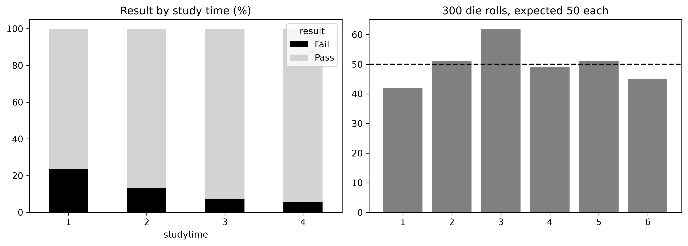

# Experiment 3: Chi-square Test on Various Data Sets

> **File:** `exp3.py`  |  **Tools:** Python 3, pandas, SciPy, Matplotlib

## 🎯 Aim

To apply the chi-square test of independence and the goodness-of-fit test.

## 📘 Theory

The chi-square statistic measures how far observed counts are from the counts expected under the null hypothesis. For two categorical variables the null hypothesis is independence, and the expected count of a cell is (row total × column total) / grand total. A p-value below 0.05 means that independence is rejected. The test needs expected counts of about 5 or more; for a 2 × 2 table Fisher's exact test is an alternative.

The data are the 649 students of the Portuguese course (UCI Student Performance). The goodness-of-fit test is shown on 300 simulated die rolls. The statistic is:

- **Null hypothesis**: The variables are independent.
- **p-value**: Probability of a result at least this extreme if the null is true.
- **Yates correction**: Continuity correction for 2 × 2 tables.
- **Fisher's exact test**: Exact test for small 2 × 2 tables.

### 📐 Formulas

$$ {\chi }^{2} = \sum_{i} \frac{{\left({O}_{i} - {E}_{i}\right)}^{2}}{{E}_{i}} $$

$$ {E}_{ij} = \frac{(row total) \times (column total)}{grand total} $$

## 🪜 Algorithm / Steps

1. Create the variable result (pass if G3 is at least 10) and test eight pairs of categorical variables.
2. Print the observed and expected counts for study time against result with the critical values.
3. Test a fair and a loaded die with chisquare.
4. Compare the chi-square and the Fisher test on school against result and draw the charts.

## 💻 Code

```python
import numpy as np
import pandas as pd
from scipy import stats
import matplotlib.pyplot as plt

por = pd.read_csv("data/student-por.csv", sep=";")
por["result"] = np.where(por.G3 >= 10, "Pass", "Fail")


def report(a, b, data=por):
    t = pd.crosstab(data[a], data[b])
    chi2, p, dof, e = stats.chi2_contingency(t)
    print(
        f"{a:>9} x {b:<8} chi2 {chi2:8.2f}  dof {dof}  p {p:.3g}  {'dependent' if p < .05 else 'independent'}"
    )
    return t, chi2, p, dof, e


print("Portuguese course data,", len(por), "students")

for a, b in [
    ("school", "result"),
    ("sex", "result"),
    ("internet", "result"),
    ("romantic", "result"),
    ("paid", "result"),
    ("address", "school"),
    ("famsup", "schoolsup"),
]:
    report(a, b)

t, chi2, p, dof, e = report("studytime", "result")

print("\nstudy time against result")
print(t.to_string())
print(
    "expected\n"
    + pd.DataFrame(
        e.round(1), index=t.index, columns=t.columns
    ).to_string()
)
print("cells with expected below 5:", int((e < 5).sum()))
print(
    "critical value at 1 %:",
    round(stats.chi2.ppf(0.99, dof), 3),
    "| at 5 %:",
    round(stats.chi2.ppf(0.95, dof), 3),
)

die = np.random.default_rng(8).integers(1, 7, 300)
obs = np.bincount(die)[1:]
g = stats.chisquare(obs)

print(
    "\n300 rolls of a die:",
    obs.tolist(),
    "-> chi2",
    round(g.statistic, 2),
    "p",
    round(g.pvalue, 3),
)

loaded = np.array([30, 35, 40, 45, 50, 100])
g2 = stats.chisquare(loaded)

print(
    "a loaded die",
    loaded.tolist(),
    "-> chi2",
    round(g2.statistic, 2),
    "p",
    f"{g2.pvalue:.2e}",
)

m = stats.chi2_contingency(pd.crosstab(por.school, por.result))

print(
    "\n2 x 2 school against result: with Yates correction chi2",
    round(m[0], 3),
    ", odds ratio",
    round(
        stats.fisher_exact(pd.crosstab(por.school, por.result))[0], 3
    ),
    ", Fisher p",
    f"{stats.fisher_exact(pd.crosstab(por.school, por.result))[1]:.2e}",
)

fig, ax = plt.subplots(1, 2, figsize=(11, 4))
(t.div(t.sum(1), axis=0) * 100).plot.bar(
    stacked=True, ax=ax[0], color=["black", "lightgrey"], rot=0
)
ax[0].set_title("Result by study time (%)")
ax[1].bar(range(1, 7), obs, color="grey")
ax[1].axhline(50, color="black", ls="--")
ax[1].set_title("300 die rolls, expected 50 each")
plt.tight_layout()
plt.show()
```

## 🖥️ Output

```text
Portuguese course data, 649 students
   school x result   chi2    55.62  dof 1  p 8.81e-14  dependent
      sex x result   chi2     3.54  dof 1  p 0.0598  independent
 internet x result   chi2     4.49  dof 1  p 0.0341  dependent
 romantic x result   chi2     3.82  dof 1  p 0.0505  independent
     paid x result   chi2     1.30  dof 1  p 0.254  independent
  address x school   chi2    79.96  dof 1  p 3.82e-19  dependent
   famsup x schoolsup chi2     3.20  dof 1  p 0.0736  independent
studytime x result   chi2    19.30  dof 3  p 0.000237  dependent

study time against result
result     Fail  Pass
studytime            
1            50   162
2            41   264
3             7    90
4             2    33
expected
result     Fail   Pass
studytime             
1          32.7  179.3
2          47.0  258.0
3          14.9   82.1
4           5.4   29.6
cells with expected below 5: 0
critical value at 1 %: 11.345 | at 5 %: 7.815

300 rolls of a die: [42, 51, 62, 49, 51, 45] -> chi2 4.72 p 0.451
a loaded die [30, 35, 40, 45, 50, 100] -> chi2 65.0 p 1.12e-12

2 x 2 school against result: with Yates correction chi2 55.616 , odds ratio 0.19 , Fisher p 1.96e-13
```

<p align="center"></p>

## ✅ Result

School and result are strongly related (χ² = 55.62, p = 8.8 × 10⁻¹⁴), and so are address and school (χ² = 79.96), study time and result (χ² = 19.30, 3 degrees of freedom, critical value 7.815 at 5 % and 11.345 at 1 %) and internet and result (p = 0.034). Sex, relationship, paid classes and family support are not significantly related to the result (p from 0.05 to 0.25). No expected count is below 5. 300 rolls of a die gave χ² = 4.72 (p = 0.451), a fair die; the loaded die gave 65.0 (p = 1.1 × 10⁻¹²). Fisher's exact test confirms the school result (odds ratio 0.19, p = 1.96 × 10⁻¹³).

## 🎤 Viva Questions

**Q. What does the chi-square test of independence check?**  
A. Whether two categorical variables are related, by comparing observed counts with the counts expected if they were independent.

**Q. How is the expected count calculated?**  
A. Row total times column total divided by the grand total.

**Q. When is the null hypothesis rejected?**  
A. When the p-value is below the significance level, usually 0.05.

**Q. What are the degrees of freedom of a table?**  
A. (number of rows − 1) × (number of columns − 1).

**Q. What does Cramér's V show?**  
A. The strength of the relation between two categorical variables, from 0 to 1.

---
[⬅ Back to index](README.md)
