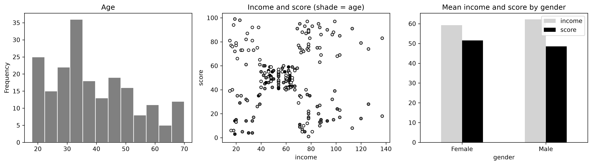

# Experiment 5: Data Storage, Analysis and Visualization

> **File:** `exp5.py`  |  **Tools:** Python 3, pandas, sqlite3, Matplotlib

## 🎯 Aim

To store data in several formats, query it and visualise it.

## 📘 Theory

Data can be stored as delimited text (CSV, TSV), as JSON, as a pickle (Python's own binary format) or in a relational database. Text formats can be read anywhere, a pickle keeps exact Python types and is fast, and a SQLite database can be queried with SQL, indexed and updated. After writing, each file is read back and compared with the original.

The Mall Customer data (200 customers: gender, age, annual income in thousand dollars and spending score) is stored in five ways, analysed with SQL (GROUP BY, CASE, ORDER BY, index) and with pandas, and drawn.

- **Pickle**: Binary storage of Python objects.
- **SQLite**: File based relational database.
- **CASE**: Conditional expression in SQL.
- **Index**: Structure that speeds up searches.

## 🪜 Algorithm / Steps

1. Write the table to CSV, TSV, JSON, pickle and SQLite and print the file sizes.
2. Read each file back and compare the income column.
3. Query the database by gender and by age band, list the best spenders and create an index.
4. Write a summary JSON file and calculate correlations.
5. Draw the age histogram, income against score and the means by gender.

## 💻 Code

```python
import json, os, sqlite3, pickle
import pandas as pd
import matplotlib.pyplot as plt

mall = pd.read_csv("data/mall.csv")
mall.columns = ["id", "gender", "age", "income", "score"]
os.makedirs("out/store", exist_ok=True)
mall.to_csv("out/store/mall.csv", index=False)
mall.to_json("out/store/mall.json", orient="table")
mall.to_pickle("out/store/mall.pkl")
mall.to_csv("out/store/mall.tsv", index=False, sep="\t")
con = sqlite3.connect("out/store/mall.db")
mall.to_sql("customer", con, if_exists="replace", index=False)
for f in sorted(os.listdir("out/store")):
    print(f"{f:<12} {os.path.getsize('out/store/' + f) / 1024:7.1f} KB")

print("\nreading back")

rt = {
    "csv": pd.read_csv("out/store/mall.csv"),
    "json": pd.read_json("out/store/mall.json", orient="table"),
    "pickle": pd.read_pickle("out/store/mall.pkl"),
    "tsv": pd.read_csv("out/store/mall.tsv", sep="\t"),
    "sql": pd.read_sql("select * from customer", con),
}
for k, v in rt.items():
    print(
        f"  {k:<7} shape {v.shape}  same income column: {bool((v.income.values == mall.income.values).all())}"
    )

print("\nSQL")
print(
    pd.read_sql(
        "select gender, count(*) n, round(avg(age),1) age, round(avg(income),1) income, round(avg(score),1) score from customer group by gender",
        con,
    ).to_string(index=False)
)
print(
    pd.read_sql(
        "select case when age < 30 then 'under 30' when age < 50 then '30-49' else '50+' end band, count(*) n, round(avg(score),1) score from customer group by band order by band",
        con,
    ).to_string(index=False)
)
print(
    pd.read_sql(
        "select id, age, income, score from customer where score > 90 order by income desc limit 3",
        con,
    ).to_string(index=False)
)

con.execute("create index idx_income on customer(income)")

print(
    "rows with income between 60 and 80:",
    con.execute(
        "select count(*) from customer where income between 60 and 80"
    ).fetchone()[0],
)

con.close()

with open("out/store/summary.json", "w") as f:
    json.dump(
        {
            "customers": len(mall),
            "mean_income": round(mall.income.mean(), 2),
            "top_score": int(mall.score.max()),
        },
        f,
    )

print("\nsummary file:", open("out/store/summary.json").read())
print(
    "income and score correlation:",
    round(mall.income.corr(mall.score), 3),
    "| age and score:",
    round(mall.age.corr(mall.score), 3),
)

fig, ax = plt.subplots(1, 3, figsize=(14, 4))
mall.age.plot.hist(bins=12, ax=ax[0], color="grey", edgecolor="white")
ax[0].set_title("Age")
ax[1].scatter(
    mall.income,
    mall.score,
    c=mall.age,
    cmap="Greys",
    edgecolor="black",
    s=22,
)
ax[1].set_xlabel("income")
ax[1].set_ylabel("score")
ax[1].set_title("Income and score (shade = age)")
mall.groupby("gender")[["income", "score"]].mean().plot.bar(
    ax=ax[2], color=["lightgrey", "black"], rot=0
)
ax[2].set_title("Mean income and score by gender")
plt.tight_layout()
plt.show()
```

## 🖥️ Output

```text
mall.csv         3.7 KB
mall.db          8.0 KB
mall.json       14.2 KB
mall.pkl         7.7 KB
mall.tsv         3.7 KB

reading back
  csv     shape (200, 5)  same income column: True
  json    shape (200, 5)  same income column: True
  pickle  shape (200, 5)  same income column: True
  tsv     shape (200, 5)  same income column: True
  sql     shape (200, 5)  same income column: True

SQL
gender   n  age  income  score
Female 112 38.1    59.3   51.5
  Male  88 39.8    62.2   48.5
    band   n  score
   30-49 100   50.9
     50+  45   38.4
under 30  55   58.6
 id  age  income  score
194   38     113     91
186   30      99     97
174   36      87     92
rows with income between 60 and 80: 70

summary file: {"customers": 200, "mean_income": 60.56, "top_score": 99}
income and score correlation: 0.01 | age and score: -0.327
```

<p align="center"></p>

## ✅ Result

CSV and TSV take 3.7 KB, the pickle 7.7 KB, the database 8.0 KB and the JSON 14.2 KB; all five give back identical data (200 rows, 5 columns). The 112 women have a mean score of 51.5 against 48.5 for the 88 men. The customers under 30 spend most (mean score 58.6), those aged 50 and more least (38.4). The best spenders by income are the customers 194, 186 and 174, and 70 customers earn between 60 and 80. Income and score are unrelated (0.010) but age and score are negatively correlated (−0.327).

## 🎤 Viva Questions

**Q. Which formats were used to store the data?**  
A. CSV, JSON and an SQLite database.

**Q. What is the advantage of a database?**  
A. It can be queried with SQL without loading all the data, and it keeps types and relations.

**Q. How do you read an SQL table into pandas?**  
A. With pd.read_sql(query, connection).

**Q. What is a round-trip check?**  
A. Reading the stored data back and comparing it with the original to be sure nothing was lost.

**Q. Which chart is used to compare group averages?**  
A. A bar chart; a box plot shows the spread as well.

---
[⬅ Back to index](README.md)
