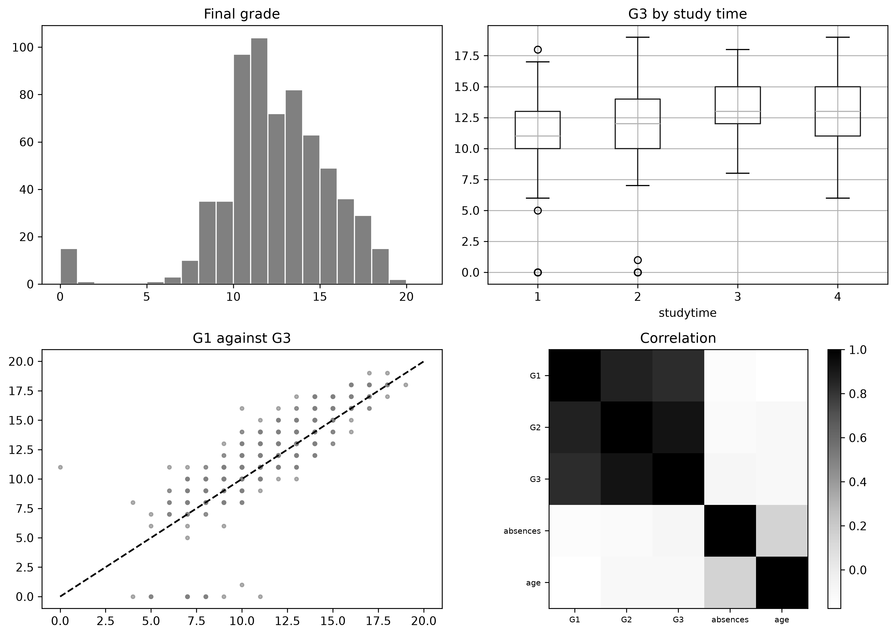

# Experiment 6: Descriptive Statistics and Data Visualization

> **File:** `exp6.py`  |  **Tools:** Python 3, pandas, SciPy, Matplotlib

## 🎯 Aim

To summarise a data set with descriptive statistics and charts.

## 📘 Theory

Descriptive statistics describe the centre (mean, median, mode), the spread (variance, standard deviation, interquartile range, coefficient of variation) and the shape (skewness, kurtosis) of each variable. Correlation measures the linear (Pearson) or rank (Spearman) relation of two variables. A confidence interval gives the range of the mean, and the t-test, the paired t-test and the one-way ANOVA compare means.

The 649 students of the Portuguese course are used, with the grades G1, G2 and G3 (0 to 20), the absences and the age.

- **Coefficient of variation**: Standard deviation as a percentage of the mean.
- **Spearman**: Correlation of ranks.
- **Confidence interval**: Range likely to hold the true mean.
- **ANOVA**: Test of equal means in several groups.

## 🪜 Algorithm / Steps

1. Print describe() for the grades, absences and age.
2. Add median, mode, variance, IQR, skewness, kurtosis and the coefficient of variation; count outliers.
3. Calculate Pearson and Spearman correlations and the confidence interval of the mean G3.
4. Compare G3 between sexes, G1 against G3 and across study times.
5. Draw a histogram, box plots by study time, a scatter plot and the correlation matrix.

## 💻 Code

```python
import numpy as np
import pandas as pd
import matplotlib.pyplot as plt
from scipy import stats

por = pd.read_csv("data/student-por.csv", sep=";")
g = por[["G1", "G2", "G3", "absences", "age"]]

print("students:", len(por))
print(g.describe().round(2).to_string())

print("\nextra measures")

ex = pd.DataFrame(
    {
        "median": g.median(),
        "mode": g.mode().iloc[0],
        "variance": g.var(),
        "IQR": g.quantile(0.75) - g.quantile(0.25),
        "skew": g.skew(),
        "kurt": g.kurt(),
        "cv %": g.std() / g.mean() * 100,
    }
)

print(ex.round(2).to_string())

q1, q3 = g.absences.quantile([0.25, 0.75])

print(
    "\nabsences: Q1",
    q1,
    "Q3",
    q3,
    "upper fence",
    q3 + 1.5 * (q3 - q1),
    "| outliers",
    int((g.absences > q3 + 1.5 * (q3 - q1)).sum()),
)
print(
    "grades of zero in G3:",
    int((por.G3 == 0).sum()),
    "| the final grade is at most",
    int(por.G3.max()),
)

print("\nPearson correlation")
print(g.corr().round(3).to_string())
print("Spearman G1-G3:", round(stats.spearmanr(g.G1, g.G3)[0], 3))

low, hi = stats.t.interval(
    0.95, len(g) - 1, g.G3.mean(), stats.sem(g.G3)
)

print(
    f"\n95 % confidence interval of the mean G3: {low:.2f} to {hi:.2f}"
)
print(
    "mean G3 by sex:",
    por.groupby("sex").G3.mean().round(2).to_dict(),
    "| t-test p =",
    f'{stats.ttest_ind(por[por.sex == "F"].G3, por[por.sex == "M"].G3).pvalue:.4f}',
)
print(
    "G1 against G3 paired t-test p =",
    f"{stats.ttest_rel(g.G1, g.G3).pvalue:.2e}",
    "| mean change",
    round((g.G3 - g.G1).mean(), 2),
)
print(
    "one-way ANOVA of G3 across study time: F =",
    round(
        stats.f_oneway(
            *[x.G3 for _, x in por.groupby("studytime")]
        ).statistic,
        2,
    ),
    ", p =",
    f"{stats.f_oneway(*[x.G3 for _, x in por.groupby('studytime')]).pvalue:.2e}",
)

fig, ax = plt.subplots(2, 2, figsize=(11, 8))
ax[0, 0].hist(g.G3, bins=range(0, 22), color="grey", edgecolor="white")
ax[0, 0].set_title("Final grade")
por.boxplot(column="G3", by="studytime", ax=ax[0, 1])
ax[0, 1].set_title("G3 by study time")
plt.sca(ax[0, 1])
plt.suptitle("")
ax[1, 0].scatter(g.G1, g.G3, s=10, color="grey", alpha=0.6)
ax[1, 0].plot([0, 20], [0, 20], "k--")
ax[1, 0].set_title("G1 against G3")
im = ax[1, 1].imshow(g.corr(), cmap="Greys")
ax[1, 1].set_xticks(range(5))
ax[1, 1].set_xticklabels(g.columns, fontsize=7)
ax[1, 1].set_yticks(range(5))
ax[1, 1].set_yticklabels(g.columns, fontsize=7)
plt.colorbar(im, ax=ax[1, 1])
ax[1, 1].set_title("Correlation")
plt.tight_layout()
plt.show()
```

## 🖥️ Output

```text
students: 649
           G1      G2      G3  absences     age
count  649.00  649.00  649.00    649.00  649.00
mean    11.40   11.57   11.91      3.66   16.74
std      2.75    2.91    3.23      4.64    1.22
min      0.00    0.00    0.00      0.00   15.00
25%     10.00   10.00   10.00      0.00   16.00
50%     11.00   11.00   12.00      2.00   17.00
75%     13.00   13.00   14.00      6.00   18.00
max     19.00   19.00   19.00     32.00   22.00

extra measures
          median  mode  variance  IQR  skew  kurt    cv %
G1          11.0    10      7.54  3.0 -0.00  0.04   24.08
G2          11.0    11      8.49  3.0 -0.36  1.66   25.18
G3          12.0    11     10.44  4.0 -0.91  2.71   27.13
absences     2.0     0     21.54  6.0  2.02  5.78  126.81
age         17.0    17      1.48  2.0  0.42  0.07    7.27

absences: Q1 0.0 Q3 6.0 upper fence 15.0 | outliers 21
grades of zero in G3: 15 | the final grade is at most 19

Pearson correlation
             G1     G2     G3  absences    age
G1        1.000  0.865  0.826    -0.147 -0.174
G2        0.865  1.000  0.919    -0.125 -0.107
G3        0.826  0.919  1.000    -0.091 -0.107
absences -0.147 -0.125 -0.091     1.000  0.150
age      -0.174 -0.107 -0.107     0.150  1.000
Spearman G1-G3: 0.883

95 % confidence interval of the mean G3: 11.66 to 12.16
mean G3 by sex: {'F': 12.25, 'M': 11.41} | t-test p = 0.0010
G1 against G3 paired t-test p = 3.45e-12 | mean change 0.51
one-way ANOVA of G3 across study time: F = 15.88 , p = 5.71e-10
```

<p align="center"></p>

## ✅ Result

The mean final grade G3 is 11.91 (median 12, standard deviation 3.23, skewness −0.91, 15 students with a grade of 0). The absences are strongly skewed (skewness 2.02, coefficient of variation 126.8 %) with 21 outliers above 15. G3 is correlated with G2 (0.919) and G1 (0.826) but only weakly with the absences (−0.091). The 95 % confidence interval of the mean G3 is 11.66 to 12.16. Girls (12.25) score above boys (11.41, p = 0.0010), G3 is on average 0.51 above G1 (paired p = 3.5 × 10⁻¹²), and the study time makes a difference (ANOVA F = 15.88, p = 5.7 × 10⁻¹⁰).

## 🎤 Viva Questions

**Q. Which measures describe the centre of the data?**  
A. Mean, median and mode.

**Q. Which measures describe the spread?**  
A. Variance, standard deviation, range and interquartile range.

**Q. What does skewness show?**  
A. The lack of symmetry; a positive value means a long right tail.

**Q. How are outliers found by the IQR rule?**  
A. Values above Q3 + 1.5 × IQR or below Q1 − 1.5 × IQR.

**Q. What does a Q-Q plot show?**  
A. Whether the data follow a normal distribution; the points lie on a straight line if they do.

---
[⬅ Back to index](README.md)
