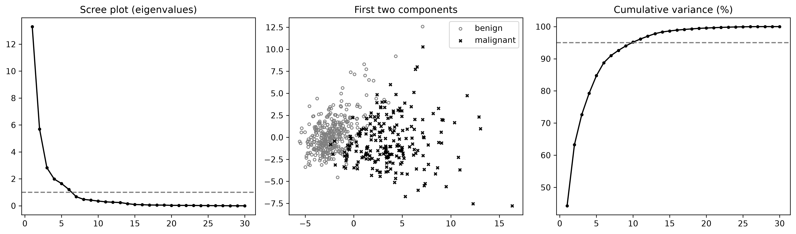

# Experiment 7: Principal Component Analysis

> **File:** `exp7.py`  |  **Tools:** Python 3, pandas, scikit-learn, Matplotlib

## 🎯 Aim

To reduce the dimension of a data set with principal component analysis.

## 📘 Theory

PCA rotates the standardised data so that the new axes, the principal components, are uncorrelated and ordered by the variance they carry. The eigenvalue of a component is its variance. The number of components to keep is chosen by the cumulative explained variance (for example 95 %), by the scree plot or by the Kaiser rule (eigenvalue above 1).

The breast cancer data of scikit-learn (569 tumours, 30 measurements, 357 benign and 212 malignant) is used. The data is standardised, the components are interpreted through their loadings, and a classifier is trained on the first k components to see what the reduction costs. The relations are:

- **Eigenvalue**: Variance of a component.
- **Scree plot**: Eigenvalues in descending order.
- **Kaiser rule**: Keep components with an eigenvalue above 1.
- **Loading**: Weight of a variable in a component.

### 📐 Formulas

$$ C v = \lambda v $$

$$ {share of PC}_{k} = \frac{{\lambda }_{k}}{\sum_{j} {\lambda }_{j}} $$

## 🪜 Algorithm / Steps

1. Standardise the 30 measurements and fit a PCA.
2. Print the explained variance, the cumulative variance and the components needed for 80, 90, 95 and 99 %.
3. Interpret the loadings and check that the scores are uncorrelated.
4. Train logistic regression on 1, 2, 5, 10 and 30 components with 5-fold cross validation.
5. Draw the scree plot, the first two components and the cumulative variance.

## 💻 Code

```python
import numpy as np
import pandas as pd
import matplotlib.pyplot as plt
from sklearn.datasets import load_breast_cancer
from sklearn.decomposition import PCA
from sklearn.preprocessing import StandardScaler
from sklearn.linear_model import LogisticRegression
from sklearn.model_selection import cross_val_score

d = load_breast_cancer(as_frame=True)
X, y = d.data, d.target

print(
    "breast cancer data:",
    X.shape,
    "| benign",
    int(y.sum()),
    "| malignant",
    int((1 - y).sum()),
)

Z = StandardScaler().fit_transform(X)
pca = PCA().fit(Z)
cum = np.cumsum(pca.explained_variance_ratio_)

print(
    "explained variance of PC1..PC5:",
    np.round(pca.explained_variance_ratio_[:5] * 100, 2),
)
print("cumulative:", np.round(cum[:6] * 100, 1))

for t in (0.80, 0.90, 0.95, 0.99):
    print(
        f"components for {t * 100:.0f} %: {int(np.searchsorted(cum, t) + 1)}"
    )

print(
    "sum of all explained shares:",
    round(pca.explained_variance_ratio_.sum(), 4),
    "| eigenvalues above 1 (Kaiser):",
    int((pca.explained_variance_ > 1).sum()),
)

L = pd.DataFrame(
    pca.components_[:2].T, index=X.columns, columns=["PC1", "PC2"]
)

print(
    "\nstrongest loadings on PC1:",
    L.PC1.abs().sort_values(ascending=False).head(3).index.tolist(),
)
print(
    "strongest loadings on PC2:",
    L.PC2.abs().sort_values(ascending=False).head(3).index.tolist(),
)

S = pca.transform(Z)

print(
    "correlation between PC1 and PC2 scores:",
    round(np.corrcoef(S[:, 0], S[:, 1])[0, 1], 6),
)
print(
    "mean PC1 of malignant",
    round(S[y == 0, 0].mean(), 2),
    "| of benign",
    round(S[y == 1, 0].mean(), 2),
)

print("\naccuracy of logistic regression (5-fold)")

for k in (1, 2, 5, 10, 30):
    Zk = PCA(n_components=k).fit_transform(Z)
    print(
        f"  with {k:>2} components: {cross_val_score(LogisticRegression(max_iter=2000), Zk, y, cv=5).mean() * 100:.2f} %"
    )
Zi = PCA(n_components=0.95).fit(Z)

print(
    "keeping 95 % variance needs",
    Zi.n_components_,
    "components; inverse transform error",
    round(
        float(
            np.mean((Z - Zi.inverse_transform(Zi.transform(Z))) ** 2)
        ),
        4,
    ),
)

fig, ax = plt.subplots(1, 3, figsize=(14, 4.2))
ax[0].plot(range(1, 31), pca.explained_variance_, "ko-", ms=3)
ax[0].axhline(1, color="grey", ls="--")
ax[0].set_title("Scree plot (eigenvalues)")
ax[1].scatter(
    S[y == 1, 0],
    S[y == 1, 1],
    s=12,
    facecolors="none",
    edgecolors="grey",
    label="benign",
)
ax[1].scatter(
    S[y == 0, 0],
    S[y == 0, 1],
    s=12,
    marker="x",
    color="black",
    label="malignant",
)
ax[1].legend()
ax[1].set_title("First two components")
ax[2].plot(range(1, 31), cum * 100, "ko-", ms=3)
ax[2].axhline(95, color="grey", ls="--")
ax[2].set_title("Cumulative variance (%)")
plt.tight_layout()
plt.show()
```

## 🖥️ Output

```text
breast cancer data: (569, 30) | benign 357 | malignant 212
explained variance of PC1..PC5: [44.27 18.97  9.39  6.6   5.5 ]
cumulative: [44.3 63.2 72.6 79.2 84.7 88.8]
components for 80 %: 5
components for 90 %: 7
components for 95 %: 10
components for 99 %: 17
sum of all explained shares: 1.0 | eigenvalues above 1 (Kaiser): 6

strongest loadings on PC1: ['mean concave points', 'mean concavity', 'worst concave points']
strongest loadings on PC2: ['mean fractal dimension', 'fractal dimension error', 'worst fractal dimension']
correlation between PC1 and PC2 scores: 0.0
mean PC1 of malignant 3.71 | of benign -2.21

accuracy of logistic regression (5-fold)
  with  1 components: 91.22 %
  with  2 components: 95.26 %
  with  5 components: 97.19 %
  with 10 components: 97.89 %
  with 30 components: 98.07 %
keeping 95 % variance needs 10 components; inverse transform error 0.0484
```

<p align="center"></p>

## ✅ Result

The first five components explain 44.27 %, 18.97 %, 9.39 %, 6.60 % and 5.50 % of the variance. 5 components keep 80 %, 7 keep 90 %, 10 keep 95 % and 17 keep 99 %; six eigenvalues are above 1. PC1 is dominated by the concavity of the nucleus (mean concave points, mean concavity) and PC2 by the fractal dimension. The scores are uncorrelated (0.0). Malignant tumours have a mean PC1 of 3.71 and benign ones −2.21. Logistic regression reaches 91.22 % on one component, 95.26 % on two, 97.89 % on ten and 98.07 % on all thirty, so ten components cost only 0.18 points.

## 🎤 Viva Questions

**Q. What is PCA?**  
A. A method that replaces correlated variables by fewer uncorrelated principal components that keep most of the variance.

**Q. Why is the data standardised first?**  
A. Otherwise the variable with the largest scale would dominate the components.

**Q. What are eigenvalues and eigenvectors in PCA?**  
A. The eigenvectors of the covariance matrix are the components and the eigenvalues are their variances.

**Q. What does a scree plot show?**  
A. The variance explained by each component.

**Q. What are loadings?**  
A. The weights of the original variables in a component.

---
[⬅ Back to index](README.md)
