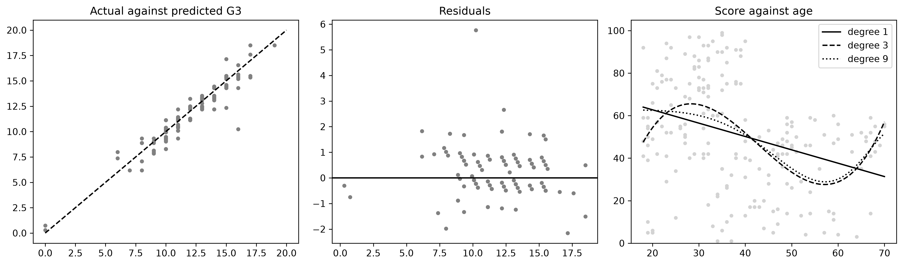

# Experiment 8: Linear Regression

> **File:** `exp8.py`  |  **Tools:** Python 3, pandas, scikit-learn, Matplotlib

## 🎯 Aim

To fit and evaluate linear and polynomial regression models.

## 📘 Theory

Linear regression predicts a number as a weighted sum of the inputs, using the weights that minimise the squared errors. The quality is judged on test data by R² and by the root mean squared error. Polynomial regression adds powers of the input; a high degree follows the training data too closely (overfitting), which shows as a good training R² and a poor test R². A ridge penalty shrinks the weights and limits this.

Part A predicts the final grade of 649 students from ten columns, with the first two period grades as the main inputs. Part B predicts the spending score of 200 mall customers from the age with polynomials of degree 1 to 9. The model is:

- **R²**: Share of the variation explained.
- **RMSE**: Typical size of the error.
- **Overfitting**: Good on training data, poor on new data.
- **Ridge**: Regression with a penalty on the weights.

### 📐 Formulas

$$ y = {\beta }_{0} + {\beta }_{1}{x}_{1} + {\beta }_{2}{x}_{2} + \epsilon $$

$$ \hat{\beta} = {\left({X}^{T}X\right)}^{-1}{X}^{T}y $$

$$ {R}^{2} = 1 - \frac{{SS}_{res}}{{SS}_{tot}} $$

## 🪜 Algorithm / Steps

1. Split the students 80:20 and fit models with G2 only, G1 and G2, all ten columns and without the grades.
2. Print the equation, the weights, the cross validated R² and the residual summary.
3. Fit polynomials of degree 1, 2, 3, 5 and 9 for the score against the age and a ridge model of degree 9.
4. Draw actual against predicted values, the residuals and the polynomial curves.

## 💻 Code

```python
import numpy as np
import pandas as pd
import matplotlib.pyplot as plt
from sklearn.linear_model import LinearRegression, Ridge
from sklearn.preprocessing import PolynomialFeatures
from sklearn.pipeline import make_pipeline
from sklearn.model_selection import train_test_split, cross_val_score
from sklearn.metrics import r2_score, mean_squared_error

mall = pd.read_csv("data/mall.csv")
mall.columns = ["id", "gender", "age", "income", "score"]
por = pd.read_csv("data/student-por.csv", sep=";")

print("Part A: predict the final grade G3 of", len(por), "students")

cols = [
    "G1",
    "G2",
    "studytime",
    "failures",
    "absences",
    "Medu",
    "Fedu",
    "freetime",
    "goout",
    "health",
]
X, y = por[cols], por.G3
Xtr, Xte, ytr, yte = train_test_split(
    X, y, test_size=0.2, random_state=3
)
for name, c in [
    ("G2 only", ["G2"]),
    ("G1 and G2", ["G1", "G2"]),
    ("all ten", cols),
    ("without G1, G2", cols[2:]),
]:
    m = LinearRegression().fit(Xtr[c], ytr)
    p = m.predict(Xte[c])
    print(
        f"  {name:<15} test R2 {r2_score(yte, p):.3f}   RMSE {np.sqrt(mean_squared_error(yte, p)):.2f}"
    )
m = LinearRegression().fit(Xtr[["G1", "G2"]], ytr)

print(
    f"  G3 = {m.intercept_:.2f} + {m.coef_[0]:.3f} G1 + {m.coef_[1]:.3f} G2"
)

full = LinearRegression().fit(Xtr, ytr)

print(
    "  weights of the ten columns:",
    {c: round(float(w), 2) for c, w in zip(cols, full.coef_)},
)
print(
    "  cross validated R2 (5 folds):",
    round(cross_val_score(LinearRegression(), X, y, cv=5).mean(), 3),
)

r = yte - full.predict(Xte)

print(
    "  residual mean",
    round(r.mean(), 3),
    "| largest miss",
    round(r.abs().max(), 2),
    "| share within 1 grade point",
    round((r.abs() <= 1).mean() * 100, 1),
    "%",
)

print(
    "\nPart B: spending score of",
    len(mall),
    "mall customers from the age",
)

a = mall[["age"]]
s = mall.score
Atr, Ate, str_, ste = train_test_split(
    a, s, test_size=0.25, random_state=1
)
for deg in (1, 2, 3, 5, 9):
    pm = make_pipeline(PolynomialFeatures(deg), LinearRegression()).fit(
        Atr, str_
    )
    print(
        f"  degree {deg}: train R2 {pm.score(Atr, str_):.3f}   test R2 {pm.score(Ate, ste):.3f}"
    )
rg = make_pipeline(PolynomialFeatures(9), Ridge(alpha=1.0)).fit(
    Atr, str_
)

print(
    "  degree 9 with ridge penalty: test R2",
    round(rg.score(Ate, ste), 3),
)
print(
    "  correlation of age and score:",
    round(a.age.corr(s), 3),
    "| with income:",
    round(mall.income.corr(s), 3),
)

fig, ax = plt.subplots(1, 3, figsize=(14, 4.2))
pg = (
    LinearRegression()
    .fit(Xtr[["G1", "G2"]], ytr)
    .predict(Xte[["G1", "G2"]])
)
ax[0].scatter(yte, pg, s=12, color="grey")
ax[0].plot([0, 20], [0, 20], "k--")
ax[0].set_title("Actual against predicted G3")
ax[1].scatter(pg, yte - pg, s=12, color="grey")
ax[1].axhline(0, color="black")
ax[1].set_title("Residuals")
xs = np.linspace(18, 70, 200).reshape(-1, 1)
ax[2].scatter(a, s, s=10, color="lightgrey")
for deg, ls in ((1, "-"), (3, "--"), (9, ":")):
    ax[2].plot(
        xs,
        make_pipeline(PolynomialFeatures(deg), LinearRegression())
        .fit(Atr, str_)
        .predict(xs),
        "k",
        ls=ls,
        label=f"degree {deg}",
    )
ax[2].set_ylim(0, 105)
ax[2].legend()
ax[2].set_title("Score against age")
plt.tight_layout()
plt.show()
```

## 🖥️ Output

```text
Part A: predict the final grade G3 of 649 students
  G2 only         test R2 0.888   RMSE 0.98
  G1 and G2       test R2 0.892   RMSE 0.97
  all ten         test R2 0.887   RMSE 0.99
  without G1, G2  test R2 0.114   RMSE 2.76
  G3 = -0.29 + 0.149 G1 + 0.904 G2
  weights of the ten columns: {'G1': 0.14, 'G2': 0.88, 'studytime': 0.09, 'failures': -0.26, 'absences': 0.03, 'Medu': -0.05, 'Fedu': 0.05, 'freetime': -0.05, 'goout': -0.02, 'health': -0.07}
  cross validated R2 (5 folds): 0.819
  residual mean 0.233 | largest miss 6.08 | share within 1 grade point 80.8 %

Part B: spending score of 200 mall customers from the age
  degree 1: train R2 0.117   test R2 0.064
  degree 2: train R2 0.117   test R2 0.066
  degree 3: train R2 0.235   test R2 0.114
  degree 5: train R2 0.196   test R2 0.096
  degree 9: train R2 0.188   test R2 0.116
  degree 9 with ridge penalty: test R2 0.104
  correlation of age and score: -0.327 | with income: 0.01
```

<p align="center"></p>

## ✅ Result

G2 alone predicts the final grade with a test R² of 0.888 (RMSE 0.98); adding G1 gives 0.892 and the equation G3 = −0.29 + 0.149 G1 + 0.904 G2. All ten columns give no gain (0.887), and without G1 and G2 the R² falls to 0.114 (RMSE 2.76). The cross validated R² is 0.819 and 80.8 % of the test predictions are within one grade point. For the mall data the age explains very little: the best test R² is 0.116 (degree 9) and the linear model has 0.064; degree 3 has a training R² of 0.235 against a test R² of 0.114, and the ridge penalty on degree 9 gives 0.104. The relation of age and score is weak (−0.327) and income does not help (0.010).

## 🎤 Viva Questions

**Q. What does linear regression do?**  
A. It fits a straight line or plane to predict a number from one or more inputs by least squares.

**Q. What does R² mean?**  
A. The share of the variation of the target that the model explains.

**Q. What is a residual?**  
A. The actual value minus the predicted value.

**Q. Why use a train and test split?**  
A. To measure the error on data that the model has not seen.

**Q. What is the normal equation?**  
A. β = (XᵀX)⁻¹Xᵀy, the direct solution of least squares.

---
[⬅ Back to index](README.md)
