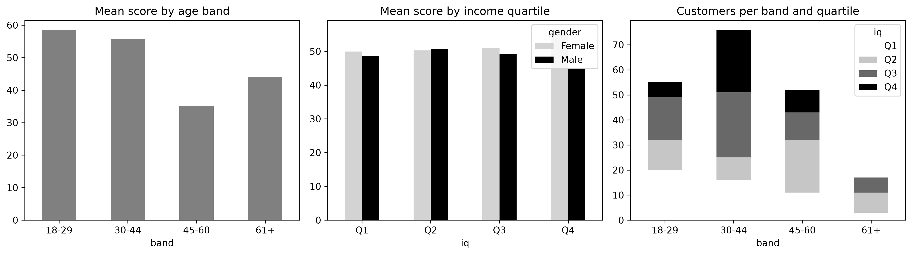

# Experiment 9: Data Aggregation and GroupWise Operations

> **File:** `exp9.py`  |  **Tools:** Python 3, pandas, NumPy, Matplotlib

## 🎯 Aim

To aggregate data and perform group-wise operations in pandas.

## 📘 Theory

Group-wise work follows the split-apply-combine pattern. groupby() splits the rows by one or more keys, agg() calculates several summaries for each group, transform() gives a group value for every row (for example the group mean or a rank), filter() keeps or removes whole groups, and head() inside a group takes its top rows. cut() and qcut() create the groups from a number, and crosstab() and pivot_table() show two keys together. cumsum() and rolling() work inside a group or along a sorted column.

The mean of group g is:

- **cut / qcut**: Groups by fixed edges / by quantiles.
- **transform()**: Group result for every row.
- **filter()**: Keeps groups that satisfy a condition.
- **crosstab()**: Counts of two keys with margins.

### 📐 Formulas

$$ {\bar{x}}_{g} = \frac{1}{{n}_{g}}\sum_{i \in g} {x}_{i} $$

## 🪜 Algorithm / Steps

1. Group the 200 customers by gender and by age band and calculate several summaries.
2. Make a pivot table of the mean score by age band and gender and the share of high spenders.
3. Add the rank of the income and the deviation of the score inside the age band.
4. Make income quartiles, filter age bands by the mean score and take the top five spenders per gender with a running total.
5. Make a crosstab with margins and draw three charts.

## 💻 Code

```python
import numpy as np
import pandas as pd
import matplotlib.pyplot as plt

mall = pd.read_csv("data/mall.csv")
mall.columns = ["id", "gender", "age", "income", "score"]
mall["band"] = pd.cut(
    mall.age,
    [17, 29, 44, 60, 80],
    labels=["18-29", "30-44", "45-60", "61+"],
)

print("customers:", len(mall))

print("\n1. by gender")
print(
    mall.groupby("gender")
    .agg(
        n=("id", "count"),
        age=("age", "mean"),
        income=("income", "mean"),
        score=("score", "mean"),
    )
    .round(2)
    .to_string()
)

print("\n2. by age band, several functions")
print(
    mall.groupby("band", observed=True)
    .score.agg(["count", "mean", "median", "std", "min", "max"])
    .round(1)
    .to_string()
)

print("\n3. pivot of mean score: age band x gender")
print(
    mall.pivot_table(
        index="band",
        columns="gender",
        values="score",
        aggfunc="mean",
        observed=True,
    )
    .round(1)
    .to_string()
)

print("\n4. share of high spenders (score > 60) per band")
print(
    (
        mall.assign(high=mall.score > 60)
        .groupby("band", observed=True)
        .high.mean()
        * 100
    )
    .round(1)
    .to_string()
)

mall["income_rank"] = (
    mall.groupby("band", observed=True).income.rank(pct=True).round(2)
)
mall["vs_band"] = (
    mall.score
    - mall.groupby("band", observed=True).score.transform("mean")
).round(1)

print("\n5. rank and deviation inside the group")
print(
    mall[["id", "band", "income", "income_rank", "score", "vs_band"]]
    .head(4)
    .to_string(index=False)
)

print("\n6. income quartiles and mean score")

mall["iq"] = pd.qcut(mall.income, 4, labels=["Q1", "Q2", "Q3", "Q4"])

print(
    mall.groupby("iq", observed=True)
    .agg(
        low=("income", "min"),
        high=("income", "max"),
        score=("score", "mean"),
    )
    .round(1)
    .to_string()
)

print("\n7. bands with a mean score above 45 (filter)")

keep = mall.groupby("band", observed=True).filter(
    lambda g: g.score.mean() > 45
)

print(keep.band.value_counts().sort_index().to_dict())

print("\n8. cumulative income of the five best spenders per gender")

top = (
    mall.sort_values("score", ascending=False)
    .groupby("gender")
    .head(5)
    .sort_values(["gender", "score"], ascending=[True, False])
)
top["running"] = top.groupby("gender").income.cumsum()

print(
    top[["gender", "score", "income", "running"]].to_string(index=False)
)

print(
    "\n9. resample like grouping with rolling mean of score sorted by income:",
    mall.sort_values("income")
    .score.rolling(20)
    .mean()
    .dropna()
    .iloc[[0, 50, 100, 170]]
    .round(1)
    .tolist(),
)
print("10. crosstab with margins")
print(pd.crosstab(mall.band, mall.iq, margins=True).to_string())

fig, ax = plt.subplots(1, 3, figsize=(14, 4))
mall.groupby("band", observed=True).score.mean().plot.bar(
    ax=ax[0], color="grey", rot=0
)
ax[0].set_title("Mean score by age band")
mall.pivot_table(
    index="iq",
    columns="gender",
    values="score",
    aggfunc="mean",
    observed=True,
).plot.bar(ax=ax[1], color=["lightgrey", "black"], rot=0)
ax[1].set_title("Mean score by income quartile")
pd.crosstab(mall.band, mall.iq).plot.bar(
    stacked=True, ax=ax[2], colormap="Greys", rot=0
)
ax[2].set_title("Customers per band and quartile")
plt.tight_layout()
plt.show()
```

## 🖥️ Output

```text
customers: 200

1. by gender
          n    age  income  score
gender                           
Female  112  38.10   59.25  51.53
Male     88  39.81   62.23  48.51

2. by age band, several functions
       count  mean  median   std  min  max
band                                      
18-29     55  58.6    56.0  23.8    5   97
30-44     76  55.7    60.5  29.3    1   99
45-60     52  35.2    42.0  17.7    4   60
61+       17  44.2    48.0  14.9    3   59

3. pivot of mean score: age band x gender
gender  Female  Male
band                
18-29     60.4  56.6
30-44     56.2  54.9
45-60     37.1  32.5
61+       47.2  42.5

4. share of high spenders (score > 60) per band
band
18-29    43.6
30-44    50.0
45-60     0.0
61+       0.0

5. rank and deviation inside the group
 id  band  income  income_rank  score  vs_band
  1 18-29      15         0.03     39    -19.6
  2 18-29      15         0.03     81     22.4
  3 18-29      16         0.06      6    -52.6
  4 18-29      16         0.06     77     18.4

6. income quartiles and mean score
    low  high  score
iq                  
Q1   15    40   49.5
Q2   42    61   50.4
Q3   62    78   50.1
Q4   79   137   51.0

7. bands with a mean score above 45 (filter)
{'18-29': 55, '30-44': 76, '45-60': 0, '61+': 0}

8. cumulative income of the five best spenders per gender
gender  score  income  running
Female     99      19       19
Female     98      23       42
Female     95      86      128
Female     94      18      146
Female     93      81      227
  Male     97      77       77
  Male     97      99      176
  Male     95      71      247
  Male     93      75      322
  Male     92      38      360

9. resample like grouping with rolling mean of score sorted by income: [51.0, 52.0, 49.1, 51.4]
10. crosstab with margins
iq     Q1  Q2  Q3  Q4  All
band                      
18-29  20  12  17   6   55
30-44  16   9  26  25   76
45-60  11  21  11   9   52
61+     3   8   6   0   17
All    50  50  60  40  200
```

<p align="center"></p>

## ✅ Result

The 112 women have a mean score of 51.53 and the 88 men 48.51. The mean score by age band is 58.6 (18–29), 55.7 (30–44), 35.2 (45–60) and 44.2 (61+). Half of the 30–44 year olds are high spenders (score above 60) and nobody over 45. The pivot table shows the women above the men in every band. The mean score is almost equal in all four income quartiles (49.5 to 51.0). Only the two youngest bands have a mean score above 45 and pass the filter (131 customers). The five best women spenders have a running income of 227 and the five best men 360. The crosstab shows 76 customers in the age band 30–44 and 25 of them in the top income quartile.

## 🎤 Viva Questions

**Q. What is the split-apply-combine idea?**  
A. Split the data into groups, apply a function to each group and combine the results.

**Q. What does groupby().agg() do?**  
A. It calculates several summaries for every group in one step.

**Q. What is a pivot table?**  
A. A table that summarises one value by two keys, with one key in the rows and one in the columns.

**Q. What does transform() do?**  
A. It returns a result for every row, such as the group mean, so it can be added as a column.

**Q. What does a crosstab show?**  
A. The counts or shares of two categorical variables against each other.

---
[⬅ Back to index](README.md)
